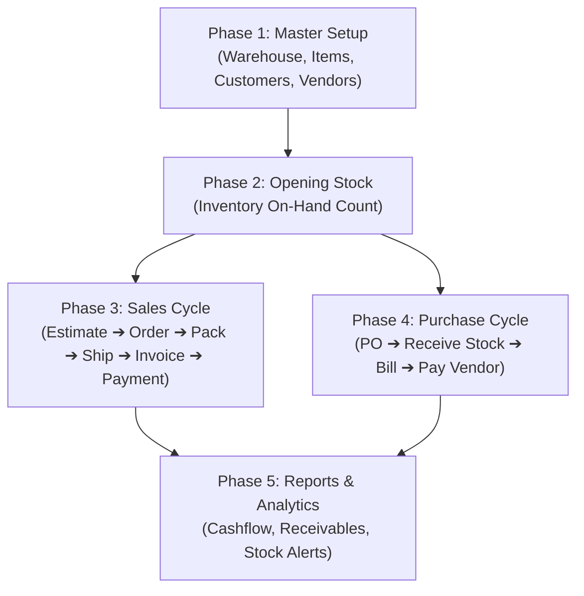

# 📦 Inventra / Oscar — Complete Business Workflow & User Guide
*(முழுமையான வணிக வழிகாட்டி மற்றும் பயன்பாட்டு முறை)*

---

## 📋 பொருளடக்கம் (Table of Contents)
1. [அமைப்பு & மேலோட்டம் (Architecture & Overview)](#1-அமைப்பு--மேலோட்டம்)
2. [Phase 1: Initial Master Setup (முதலில் செய்ய வேண்டியவை)](#phase-1-initial-master-setup-முதலில்-செய்ய-வேண்டியவை)
3. [Phase 2: Opening Stock (ஆரம்பக் கையிருப்பு பதிவு செய்தல்)](#phase-2-opening-stock-ஆரம்பக்-கையிருப்பு-பதிவு-செய்தல்)
4. [Phase 3: Sales Workflow (முழு விற்பனைச் சுழற்சி)](#phase-3-sales-workflow-முழு-விற்பனைச்-சுழற்சி)
5. [Phase 4: Purchase Workflow (பொருட்கள் வாங்கும் சுழற்சி)](#phase-4-purchase-workflow-பொருட்கள்-வாங்கும்-சுழற்சி)
6. [Phase 5: Daily Monitoring & Reports (தினசரி கண்காணிப்பு)](#phase-5-daily-monitoring--reports-தினசரி-கண்காணிப்பு)
7. [⚡ Smart Quick-Add Feature (புதிய சிறப்பு அம்சம்)](#-smart-quick-add-feature-புதிய-சிறப்பு-அம்சம்)

---

## 1. அமைப்பு & மேலோட்டம்



---

## Phase 1: Initial Master Setup (முதலில் செய்ய வேண்டியவை)

புதிதாக கணக்கு தொடங்கியதும் முதலில் கீழ்க்கண்ட மாஸ்டர் விவரங்களை வரிசையாக உருவாக்க வேண்டும்:

### 1.1. Warehouse (கிடங்கு உருவாக்கம்)
* **வழிமுறை**: Left Menu ➔ **Warehouses** ➔ **"+ New Warehouse"**
* **தேவையான விவரங்கள்**:
  * **Warehouse Name**: எ.கா: `Main Depot` அல்லது `Tiruppur Unit`
  * **Code**: `WH-01`
  * **City**: `Coimbatore`
* **காரணம்**: பொருட்கள் எந்த இடத்தில் இருப்பு வைக்கப்படுகின்றன என்பதற்கான தொடக்கப் புள்ளி.

### 1.2. Products / Items (பொருட்கள் பட்டியல்)
* **வழிமுறை**: Left Menu ➔ **Products** ➔ **"+ New Item"** (அல்லது Excel/JSON-ல் Bulk Upload செய்யவும் வசதி உள்ளது).
* **தேவையான விவரங்கள்**:
  * **Item Name**: எ.கா: `Welding Electrode 3.15mm`
  * **SKU**: `WE-315` (பொருளின் தனித்துவ அடையாள எண்)
  * **Cost Price**: ₹300 (நீங்கள் வாங்கும் அடக்க விலை)
  * **Selling Price**: ₹450 (விற்பனை விலை)
  * **Reorder Level**: `10` (இந்த அளவுக்கு கீழே குறையும்போது Alert தரும்)

### 1.3. Customers (வாடிக்கையாளர்கள்)
* **வழிமுறை**: Left Menu ➔ **Customers** ➔ **"+ Add Customer"**
* **தேவையான விவரங்கள்**:
  * **Company / Customer Name**: எ.கா: `Apex Engineering`
  * **Phone**, **Email**, **GSTIN** (இருப்பின்)
  * **State**: `Tamil Nadu` (மாநிலத்தின் அடிப்படையில் SGST/CGST அல்லது IGST தானாகவே தீர்மானிக்கப்படும்)
  * **Map Pin**: லொகேஷன் பாயின்ட் கூகுள் மேப் மூலம் குறித்து வைக்கலாம்.

### 1.4. Vendors (சப்ளையர்கள்)
* **வழிமுறை**: Left Menu ➔ **Vendors** ➔ **"+ Add Vendor"**
* **தேவையான விவரங்கள்**: பெயர், தொலைபேசி எண், சப்ளையர் முகவரி மற்றும் GSTIN.

---

## Phase 2: Opening Stock (ஆரம்பக் கையிருப்பு பதிவு செய்தல்)

வியாபாரம் தொடங்கும் போது உங்களிடம் ஏற்கனவே இருக்கும் சரக்குகளை உள்ளிட:
1. Left Menu ➔ **Inventory** பக்கத்திற்குச் செல்லவும்.
2. **"Post Single Stock"** (தனித்தனி பொருளுக்கு) அல்லது **"Quick Bulk Stock Count"** (அனைத்து பொருட்களுக்கும் ஒரே டேபிளில்) கிளிக் செய்யவும்.
3. **Warehouse** மற்றும் **Product** தேர்வு செய்து, உங்களிடமுள்ள அளவை (எ.கா: `100 Units`) கொடுத்து Save செய்யவும்.
4. இப்போது டேஷ்போர்டில் ஸ்டாக் **Available Quantity**-ஆக ஏறிவிடும்.

---

## Phase 3: Sales Workflow (முழு விற்பனைச் சுழற்சி)

ஒரு வாடிக்கையாளர் உங்களிடம் பொருள் வாங்கும் போது நடக்கும் தொடர் வழிமுறை:

```
Step 1: Estimate (Quotation) 
   ⬇
Step 2: Sales Order (Order Confirm & Stock Reservation)
   ⬇
Step 3: Package (Packing List)
   ⬇
Step 4: Shipment (Delivery - Real Stock Deducted)
   ⬇
Step 5: Invoice (Tax Invoice பில்லிங்)
   ⬇
Step 6: Payment (பணம் பெறுதல்)
```

### Step 3.1: Estimate / Quotation (விலைப்புள்ளி தயாரித்தல்)
* **வழிமுறை**: **Estimates** ➔ **"+ Create Estimate Quote"**.
* Customer மற்றும் பொருட்களை தேர்வு செய்யவும்.
* ஜிஎஸ்டி (GST 18%) தானாகவே கணக்கிடப்படும்.
* **பயன்**: இதை PDF-ஆக பிரிண்ட் செய்யலாம் அல்லது **"Share on WhatsApp"** வழியாக வாடிக்கையாளருக்கு நேரடியாக அனுப்பலாம்.
* வாடிக்கையாளர் சம்மதம் தெரிவித்தவுடன் **"Convert to Order"** கொடுத்தால் உடனடியாக Sales Order உருவாகிவிடும்.

### Step 3.2: Sales Order (விற்பனை ஆர்டர் உறுதி செய்தல்)
* **வழிமுறை**: **Sales Orders** ➔ **"+ New Order"**.
* Customer, Dispatch Warehouse, Items தேர்வு செய்து சேமிக்கவும்.
* **"Confirm"** பட்டனைக் கிளிக் செய்யவும்.
* **முக்கிய அம்சம்**: ஆர்டர் உறுதியானதும், ஸ்டாக்கில் இருக்கும் பொருட்கள் வேறு யாருக்கும் விற்கப்படாமல் **Reserved Quantity**-ஆக பாதுகாக்கப்படும்.

### Step 3.3: Packages (பேக்கிங் செய்தல்)
* **வழிமுறை**: **Packages** ➔ **"+ New Package"** (அல்லது Sales Order பக்கத்தில் இருந்தே செய்யலாம்).
* உறுதி செய்யப்பட்ட ஆர்டருக்கு பேக்கிங் ஸ்லிப் உருவாக்கப்படும்.

### Step 3.4: Shipment (சரக்கு அனுப்புதல் / டெலிவரி)
* **வழிமுறை**: **Shipments** ➔ **"Ship"** கிளிக் செய்யவும்.
* **முக்கிய அம்சம்**: Shipment முடிந்த கணமே, Warehouse-ல் உள்ள உண்மையான சரக்கு கையிருப்பு தானாக மைனஸ் (Deduct) ஆகிவிடும்.

### Step 3.5: Invoice (வரி பில் தயாரித்தல்)
* **வழிமுறை**: **Invoices** பகுதிக்குச் செல்லவும் (அல்லது Sales Order-ல் **"Create Invoice"** கிளிக் செய்யவும்).
* தொழில்முறை ஜிஎஸ்டி Tax Invoice தயாராகிவிடும்.

### Step 3.6: Payments (பணம் வரவு வைத்தல்)
* வாடிக்கையாளர் பணம் செலுத்தியதும் (Cash / UPI / Bank):
* **Payments** ➔ **"+ Record Payment"** செல்லவும்.
* Invoice எண்ணைத் தேர்ந்தெடுத்து தொகையை வரவு வைக்கவும். பில் தானாக **PAID** என மாறிவிடும்.

---

## Phase 4: Purchase Workflow (பொருட்கள் வாங்கும் சுழற்சி)

சரக்குகள் தீரும் போது சப்ளையரிடமிருந்து வாங்குவது:

1. **Purchase Orders (PO)**:
   * **Purchase Orders** ➔ **"+ New PO"**.
   * Vendor மற்றும் Receiving Warehouse-ஐ தேர்வு செய்து ஆர்டர் போடவும்.
2. **Receive Stock (சரக்கு பெறுதல் - GRN)**:
   * சரக்கு கிடங்கிற்கு வந்தவுடன், அந்த PO-ல் உள்ள **"Receive Stock"** கிளிக் செய்யவும்.
   * உடனே உங்கள் Inventory ஸ்டாக் தானாக அதிகரித்துவிடும்.
3. **Vendor Bills**:
   * சப்ளையரின் இன்வாய்ஸை கணினியில் ஏற்ற **Bills** ➔ **"+ Create Bill"** செய்யவும்.
4. **Pay Vendor**:
   * சப்ளையருக்கு பணம் செலுத்தியதும் **"Pay Bill"** கொடுத்து கணக்கை முடிக்கவும்.

---

## Phase 5: Daily Monitoring & Reports (தினசரி கண்காணிப்பு)

### Business Command Center (Dashboard):
* **Total Sales Revenue**: மொத்த வியாபாரம்.
* **Total Collected**: கைக்கு வந்த ரொக்கப் பணம்.
* **Receivables**: சந்தையில் வாடிக்கையாளர்கள் இன்னும் தராமல் பாக்கி வைத்துள்ள தொகை.
* **Bills Payable**: நீங்கள் சப்ளையர்களுக்கு கொடுக்க வேண்டிய பாக்கி.
* **Low Stock Alerts**: தீர்ந்து போகும் அபாயத்தில் உள்ள பொருட்கள் பட்டியல்.

---

## ⚡ Smart Quick-Add Feature (புதிய சிறப்பு அம்சம்)

> **முக்கிய குறிப்பு**: நீங்கள் எந்தவொரு Form-ல் (Sales Order, Estimate, Purchase Order, Stock Adjustment) இருக்கும்போதும்:
> 
> * Warehouse இல்லையா? ➔ வெளியே செல்ல வேண்டாம்! Field-ன் மேலே இருக்கும் **`⚡ + New Warehouse`** கிளிக் செய்து 2 வினாடியில் உருவாக்கி உடனே தொடரலாம்.
> * Customer இல்லையா? ➔ **`⚡ + New Customer`** கிளிக் செய்து அங்கேயே சேர்க்கலாம்.
> * Item இல்லையா? ➔ Line Items-ல் உள்ள **`+ New`** கிளிக் செய்து அங்கேயே புது பொருளை சேர்க்கலாம்.
> * முழுமையான பக்கத்திற்குச் செல்ல பக்கத்திலுள்ள **`Page ↗`** கிளிக் செய்தால் அது புதிய டேப்பில் திறக்கும். நீங்கள் தட்டச்சு செய்த எந்தத் தகவலும் அழியாது!

---
*Created for Inventra / Oscar Inventory & Billing System*

